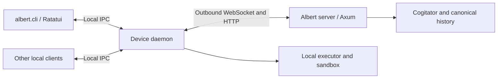

# Device daemons and shared execution environments

Status: **agreed baseline design; implementation pending**.

This document describes Albert's device-daemon direction. The initial model uses
a server-side cogitator and server-owned conversation history, with execution
available on the server and on authorized devices. A dedicated local daemon is
the central reusable component. The first client prototype is `albert.cli`,
using Ratatui. Lazy skill-package caching is described below; its inclusion in
the first implementation milestone remains to be confirmed.

Implementation discoveries should update this document.
Concrete wire formats, APIs and storage schemas remain to be selected.

## Roles

| Component | Responsibility |
| --- | --- |
| Albert server | Cognition, canonical sessions/history, work coordination, configuration, shared skill discovery, server integrations and result routing. |
| Device daemon | Authenticated execution endpoint, device capabilities, local sandbox, allowed files/processes/applications, work status and artifact transfer. |
| CLI or desktop client | A client of the local daemon for server sessions and the relevant device environment. |
| Server executor | Executes work requiring server resources or integrations under its own execution policy. |

The CLI/desktop experience can use resources on its device while the cogitator
continues to run on the server. A complete local cogitator and autonomous offline
chat history would be a separate operating mode requiring its own design.

## Connecting a device to Albert

The intended user flow is:

1. In the Albert web panel, an authorized user creates a device connection token
   and gives it a human-readable name.
2. On the device, the user chooses **Connect server** in `albert.cli` or another
   client of the daemon, enters the Albert server address and pastes the token.
3. The daemon authenticates to that server and registers the device. It reports
   the device hostname and OS, plus the protocol/capability information needed
   for the connection.
4. The server resolves the token's record and uses its name as the device's
   initial alias. The server assigns a stable device ID and associates the
   registration with the token's account and granted scope.
5. The device appears in the panel with its hostname, alias, OS and connection
   state. The daemon retains the connection profile and reconnects without
   asking the user to paste the token for every session or job.
6. The user can access the account's permitted server sessions and create
   sessions using this device's execution environment.

Token names are labels, not authentication material. Token input and storage
are handled as secrets, including across local IPC, and are excluded from
ordinary logs, job arguments and chat history. Registration metadata such as
hostname and OS is descriptive; it does not establish identity or grant rights.

The application should preserve this address-and-token experience while
establishing an authenticated encrypted connection. A bearer token authenticates
its holder to the server; it does not by itself establish trust in an arbitrary
server address. The secure bootstrap mechanism remains part of the protocol
design, and must not silently disable server verification to make onboarding
succeed.

The exact token reuse policy, expiry, and whether registration exchanges it for
a dedicated device credential remain implementation decisions. The binding
must be explicit so enrollment retries and normal reconnects recover the same
device rather than creating duplicates, and revocation has a clear effect on
the corresponding device connection.

### Multiple server profiles

One daemon can connect to multiple Albert servers. Each connection has its own
server identity/address, local profile, registered device ID, credentials and
grants. Session selection, requests, updates and outcomes retain their server
association. Switching a CLI view to another server does not retarget active
jobs or disconnect unrelated server profiles.

A session or work reference is resolved within its server context; a hostname,
token name or coincidentally equal session ID is not a cross-server identity.
Connecting several servers does not merge their histories or share credentials
between them. Package provenance and configuration lookup also retain their
server/profile association.

All profiles still use one physical device and its local policy. The daemon's
resource limits and work coordination must account for jobs from all connected
servers. Granting two profiles access to the same workspace is an explicit
shared-resource decision, not filesystem isolation created by profile names.

### Device names in sessions

The device hostname is the primary user-visible execution label. The alias
initially derived from the token name is additional metadata and can help
distinguish devices with equal or unhelpful hostnames. Neither name needs to be
globally unique.

The internal execution reference uses stable registered device identity within
its server context. Session metadata must not depend on hostname or alias
remaining unchanged. A renamed computer remains the same enrolled executor.
The existing reserved `host` reference continues to identify server-local
execution; device-backed sessions display the device's name instead.

New sessions created for the connected device default to that device as their
execution environment. Opening an existing session from a different client does
not silently move its workspace, change its executor or retarget running work.
Selecting another executor is a separate, permission-checked operation. The
cogitator and canonical session history remain on the selected Albert server
regardless of the displayed execution-device label.

## Process topology: dedicated daemon and thin clients

**The local daemon is a separate, long-lived process from the CLI.** It owns the
device's server connections, execution supervisor, sandbox adapters, local policy,
resources and recovery state. It must run without a terminal or an attached UI.
Central configuration is useful, but the daemon's purpose is the lifetime and
reuse of local execution independently of its clients.

The prototype has two processes: the headless daemon and the `albert.cli` client.
The daemon binary's final name and service packaging remain implementation
details. A manually started daemon process is sufficient during prototyping;
embedding the executor into the CLI is not the selected topology.

The daemon exposes a local client API. `albert.cli` displays state and submits
conversation and control requests through that API; the daemon relays server
operations while preserving their authenticated user and session context. The
server remains responsible for session admission and canonical history. Device
identity is not permission to impersonate every server user.

Multiple CLI or desktop clients can attach to the same daemon without creating
additional executors. One daemon owns an enrolled device's execution identity;
local ownership and connection fencing must prevent another instance from
silently executing the same jobs under that identity.

### Local client API

The minimum contract includes protocol/version negotiation, a state snapshot,
event subscription, user commands and addressed control requests with stable
request IDs. It can expose daemon availability, server connectivity, active jobs
and relevant conversation state without making the CLI an execution supervisor.

After reconnect, a client obtains an authoritative snapshot and resumes events.
A missed UI event does not lose a job or require replaying the user's command.
Per-client queues are bounded: a slow renderer or disconnected terminal cannot
block the executor or retain unlimited output in daemon memory.

Local IPC has platform-specific backends selected at compile time:

| Target | Backend |
| --- | --- |
| `#[cfg(unix)]` | Unix domain sockets, using Tokio Unix listener/stream support. |
| `#[cfg(windows)]` | Windows named pipes, using Tokio's named-pipe server/client support. |

Both implement the same asynchronous stream interface, framed message codec and
application API. Platform selection belongs inside the IPC component; Ratatui,
shared contracts and job logic do not select an operating-system transport.
Unsupported targets should fail explicitly rather than silently exposing a TCP
listener or changing the protocol.

This is a local, memory-buffered communication channel. Messages are not written
to per-message files or a file-backed IPC queue. A Unix socket pathname identifies
an endpoint rather than storing the message payload. A public or loopback HTTP
listener is not required for this client link.

Endpoint permissions and local caller identity must be checked using the
appropriate platform facilities. The shared API does not imply identical Unix
permission and Windows access-control mechanisms. Multiple clients connect
through their respective backend without creating additional executors.

Shared-memory buffers can be evaluated for future large binary payloads if
measurement shows an IPC bottleneck. They are not required for the initial
command/event channel, and maximum performance is not assumed without measuring
latency, throughput and backpressure behavior on the supported platforms.

References: [Tokio UnixListener](https://docs.rs/tokio/latest/tokio/net/struct.UnixListener.html),
[Tokio Windows named pipes](https://docs.rs/tokio/latest/tokio/net/windows/named_pipe/index.html),
and [Rust conditional compilation](https://doc.rust-lang.org/reference/conditional-compilation.html).

### Independent lifecycles

Closing `albert.cli` detaches that client. **Accepted jobs continue in the
daemon**, and their results remain accessible through server sessions and later
client attachment. Closing a view, cancelling a job and stopping the daemon are
separate operations. Client disconnect does not implicitly cancel work.

Stopping the daemon is an explicit execution-lifecycle operation: stop admitting
work, apply the declared drain/cancellation policy to active jobs, allow bounded
cleanup and report observed outcomes. The exact shutdown policy must be fixed
before implementation. It cannot depend on a Ratatui render/event loop.

A crash or power loss can leave an unknown outcome and possibly surviving child
processes. Reconciliation must establish what happened before another execution
is accepted. Graceful shutdown behavior must not be presented as a guarantee
that a forcibly terminated process performed cleanup.

## Component boundaries and selected stack

The design uses separate workspace components where they create a reusable
boundary. Start in the Albert repository; the following names describe logical
ownership rather than requiring a final package count or exact crate names.

| Component | Responsibility and dependencies |
| --- | --- |
| Shared device contracts | Versioned server-device and local-client messages, IDs, events, snapshots and errors; separate modules, independent of Ratatui and HTTP/WS framework types. |
| Headless device runtime library | Server link, job supervisor, local policy, execution adapter, resources/credentials and reconciliation; no terminal UI dependency. |
| Daemon executable | Runtime composition, local API service, enrollment/configuration startup and daemon shutdown. |
| Local client interface | Connect to the daemon, submit commands, obtain snapshots and consume events; usable by CLI and later clients. |
| `albert.cli` | Ratatui application and terminal lifecycle; displays state and issues requests through the local client interface. |
| Albert server device adapter | Axum endpoints, device admission and routing, server job state and association with Albert sessions. |

**Server:** Axum for HTTP and its `ws` feature (`WebSocketUpgrade`), whose
WebSocket implementation already uses tokio-tungstenite. **Native daemon:**
`reqwest` for HTTP and `tokio-tungstenite`/Tungstenite for WebSocket. **CLI UI:**
Ratatui. Network I/O, execution and recovery run outside the rendering loop.
Socket.IO is not part of the selected baseline.

The application message contract is implemented directly over these libraries;
this does not mean implementing WebSocket framing or cryptography. IDs,
acknowledgment meaning, state transitions and reconnect reconciliation remain
explicit application contracts, independent of an individual connection.

### CBOR messages and stream framing

Local CLI/daemon commands, responses and events use **CBOR** with shared typed
Rust contracts over both IPC backends. Application schema/version negotiation
remains explicit; CBOR alone does not define job or RPC semantics.

Local byte streams carry length-delimited CBOR messages, with a four-byte
big-endian unsigned payload-length prefix. The common codec handles partial
reads/writes and multiple messages in a read, independently of Unix socket or
named-pipe details. A configurable maximum encoded message size is checked
before allocating the full payload; decoded structure/resource limits also
belong to the contract.

The initial server-device link uses JSON control messages over HTTP and
WebSocket, with bulk file/package data transferred as byte streams. This keeps
the local IPC encoding choice independent of the network link and leaves the
web UI's JSON HTTP API unchanged. Shared domain types can support these
representations without sharing transport-specific framing.

CBOR on the network, HTTP/2-specific tuning, or a QUIC/HTTP/3 transport are future
options to evaluate after measuring representative workloads. They are not
requirements for the first prototype. If network CBOR is later adopted, a
complete WebSocket binary message can carry one CBOR application message without
the local IPC length prefix; HTTP endpoints can advertise the relevant media
type explicitly.

CBOR byte strings support binary fields without mandatory base64 conversion.
Actual encoded size and encode/decode cost should be measured on representative
messages; compact encoding does not replace buffering and flow-control design.
Human-readable diagnostics can be derived from typed events with existing
redaction rules, without persistently dumping raw credential-bearing messages.

References: [CBOR, RFC 8949](https://www.rfc-editor.org/rfc/rfc8949.html),
[Tokio length-delimited codec](https://docs.rs/tokio-util/latest/tokio_util/codec/length_delimited/index.html).

Generic process execution, sandbox adapters and reusable transport components
may live in Octo components/connectors when their boundaries are genuinely
application-independent. Albert owns session/user policy, placement, enrollment
integration and its CLI. No device-specific Albert conversation behavior belongs
in the Octo kernel. Components can be extracted later without making the first
prototype depend on a cross-repository refactor.

Stack references: [Axum WebSockets](https://docs.rs/axum/latest/axum/extract/ws/index.html),
[tokio-tungstenite](https://docs.rs/tokio-tungstenite/latest/tokio_tungstenite/),
[reqwest](https://docs.rs/reqwest/latest/reqwest/), and
[Ratatui application patterns](https://ratatui.rs/concepts/application-patterns/).

## A shared harness

The server executor and device daemons should expose a consistent work contract:
submit, inspect state, retrieve bounded output, cancel and retrieve artifacts.
Existing turn, stage, subagent and remote-job references should be reused where
they fit. A new unrelated task framework is not required to run a script.

Common execution and lifecycle code should be reused where practical, including
the existing forkd executor. Platform adapters provide the actual process,
filesystem, interpreter and sandbox behavior. Uniform protocol semantics do not
mean every operating system provides the same sandbox or installed tools.

A daemon reports available interpreters, platform requirements, accessible
workspaces, exposed local tools and current availability. Its local policy is
an upper bound on requests from the server. A model cannot grant itself wider
machine access by changing a tool argument or skill description.

An authenticated device identity is distinct from provider or integration
credentials. The bridge authenticates both endpoints and reconstructs authorized
local execution context; process-local Octo authorization objects are not trusted
serialized capabilities on another machine.

Device enrollment and configuration establish standing grants. Routine jobs
within those grants, including credential materialization, execute autonomously;
separate per-invocation credential handling does not mean asking the user to
approve every launch. The host evaluates the configured policy automatically.

## Device channel: HTTP operations and outbound events

The initial transport direction is ordinary authenticated HTTP operations for
job descriptions, script/resource delivery, status and result reporting, package
downloads and artifact transfer. HTTP requests and responses should support
streaming where needed, bounded buffering and connection reuse. Actual latency
and throughput need measurement; a WebSocket choice alone does not establish
that data transfer will be fast.

The daemon maintains an outbound WebSocket event connection for available work,
cancellation, configuration revisions and skill updates. Event notifications and
bulk HTTP transfers have separate responsibilities, without requiring separate
authentication models. Application framing/versioning remains to be designed.

The daemon initiates communication with the server. For example, the server
queues a job and sends its reference through the event channel; the daemon
retrieves the authorized job and input resources over HTTP, then reports output
and completion back to the server. Result callbacks therefore do not require
an inbound public listener on the user's device. An HTTP polling fallback is a
possible later extension, not the selected initial event transport.

An update event can carry an ID and revision rather than the full skill or
configuration. The daemon retrieves and verifies the required state. An active
job keeps its pinned version. Reconnection reconciles current revisions and job
states so a missed event does not permanently lose an update or cause completed
work to execute again. Event notification is not itself the authoritative work
or configuration record.

Large logs, packages and artifacts should stream through bounded data-transfer
paths. Only selected evidence and references enter the cogitator's context.

TLS can protect HTTP and the event channel, with the daemon verifying a configured
server trust anchor or pinned server key established during trusted enrollment. A
machine-to-machine client can have this explicit trust relationship without a
publicly trusted IP certificate. Secure initial trust distribution, key rotation
and revocation must still be designed. Browser access to the web panel has its
own certificate-trust requirements.

The enrollment/authorization token and transport session keys have separate
roles. Credential-bearing messages use an authenticated encrypted channel;
encrypting values with an ad-hoc transformation of a reusable token is not the
protocol design. An established secure-channel protocol, such as TLS or a
suitable Noise construction, should provide handshake and channel protection.
Application-level encryption over WebSocket remains an option to evaluate, not
an accepted implementation choice.

References: [WebSocket and TLS](https://www.rfc-editor.org/rfc/rfc6455.html#section-10.6),
[TLS 1.3](https://www.rfc-editor.org/rfc/rfc8446.html), and
[Noise application responsibilities](https://noiseprotocol.org/noise.html#application-responsibilities).

## Initial execution path

The first version can send a script, arguments, explicit input references,
working directory and execution limits to an identified daemon. The daemon runs
it in its permitted sandbox using an available interpreter and returns status,
bounded output and artifact references.

Code may be prepared by the server-side cogitator or come from an installed
skill. Neither path requires a complete copy of the server's skill catalog on
every device. Large or binary resources need an explicit transfer mechanism;
sending script text alone does not make its files or dependencies available.

An interpreter running on the device still belongs to the execution policy. If
a later interactive interpreter keeps state across calls, its lifetime, workspace
and cancellation scope must be explicit. Interpreting code does not bypass the
daemon's sandbox or turn it into unrestricted access to the logged-in desktop.

Missing dependencies are reported as missing capabilities or require a separately
authorized environment-preparation action. A script must not silently provision
the whole host simply because it requires another runtime or package.

## Choosing the execution node

Availability in a skill catalog and execution placement are separate properties.
A shared skill might require macOS or a device-local project; another operation
might require a server-only integration. A single request can contain both.

For example:

1. Run project tests on the Mac where the workspace is available.
2. Return selected diagnostics to the server.
3. Create an issue using the server's tracker integration.
4. Deliver the result through the user's selected channel.

Placement should consider explicit user/work scope, platform and interpreter
requirements, data location, allowed capabilities, credential availability and
node reachability. The model can select or propose a node based on advertised
capabilities; the selected executor enforces actual permission and availability.

“Server execution is impossible” is not a general fallback condition. It can
mean a known placement requirement, such as a Mac-only application or files that
are deliberately available only on a device. A timeout, missing dependency or
failed command does not establish that another node is an authorized or safe
replacement.

For the initial version, explicit placement and clear failure reporting are
sufficient. Automatic placement preferences can be added later. Work with an
unknown or partially completed outcome is reconciled before retrying, including
when changing nodes; automatic failover must not duplicate external effects.

## Shared and device-scoped skills

Installing a shared skill in Albert normally makes the server its catalog and
distribution point. Authorized devices can receive the resources needed to
execute it. An installation can also be scoped to one device so it is not offered
to unrelated environments.

A device-scoped installation can keep its scripts and resources on that device.
The server-side cogitator still needs enough metadata and instructions to discover
and use it in an authorized session. Device scope therefore means restricted
availability, not a promise that no description or instruction ever reaches the
server or model provider.

The visible catalog is derived from session/user permission, selected execution
environment and actual capabilities. Detailed instructions are loaded when
needed rather than copying every skill body into every model turn. Package
availability alone never grants its requested filesystem, network or credential
access.

## Synchronization as an optional distribution mechanism

At connection or startup, a daemon can reconcile package identifiers, versions
and required resources with the server. Subsequent reconnects or configuration
updates can repeat that reconciliation without transferring unchanged content.

The initial implementation does not need an eager mirror of all packages, an
automatic dependency installer or continuous bidirectional synchronization.
Direct script execution, selected resource transfer and advertised local skills
are enough to establish the execution contract first.

When package synchronization is introduced, server-managed packages and
device-local additions need explicit provenance and update ownership. A reconnect
must not overwrite an intentionally device-scoped installation or upload it into
the shared catalog without authorization. Canonical chat history remains on the
server and is not synchronized as a writable local database.

## Possible lazy package delivery and cache

**Optional extension:** a daemon downloads a skill's required package only when
that skill is actually invoked on the device. Metadata may be available earlier
for discovery. If an invocation executes entirely on the server, it does not
require transferring the execution package to the device.

A possible flow is:

1. Resolve the execution node and authorize the operation.
2. Select the package version and required resources for that invocation.
3. Reuse a matching authorized local package, or download and verify it against
   the expected manifest before activation.
4. Execute using that version under the device's sandbox and grants.
5. Retain the cached package for later eligible invocations.

A configurable cache retention of **one or two weeks** is a reasonable example
to evaluate. The precise duration and whether it measures age or idle time are
implementation choices, not fixed product requirements.

Running work pins its package version until it finishes. Cache cleanup must not
remove files being used by an active invocation, and an update must not replace
its code midway through execution. New work can use a newer approved version.

Cache retention is independent of authorization, credential expiry and
conversation retention. A cached package does not keep a revoked capability
alive. Expiry means a future invocation may need to fetch resources again; it
does not delete project files, results or chat history. Payload and disk quotas,
unavailable downloads and interrupted transfers need bounded, visible handling.

This option can be implemented after direct execution works. There is no need to
make the first daemon's correctness depend on a general synchronization engine.

## Credentials and data placement

Credentials and data may exist on multiple authorized nodes when execution
requires it. Avoiding every duplicate is not a hard architectural invariant.
Placement, scope, retention and the actor permitted to use each copy must be
explicit; installing a skill does not imply distributing the server's secrets.

Here, "authorized for a job" means automatic enforcement of previously granted
device, actor and operation policy. Normal credential use must not require
repeated interactive consent in Albert. Per-job delivery and cleanup describe a
resource lifetime, independently of whether any human interaction is needed.

Typical paths are:

| Need | Placement |
| --- | --- |
| Server integration such as a tracker | Execute the operation on the server using its credentials. |
| Device-local application or identity | Use credentials owned and authorized on that device. |
| A service supporting delegated access | Issue a suitably scoped, short-lived credential when appropriate. |
| A local process genuinely requiring a transferable credential | Deliver an explicitly authorized value through the execution credential mechanism, with its own storage and lifetime policy. |

Where possible, scripts refer to required credentials or call authorized server
operations instead of embedding secrets in source code or shared packages.
Credential delivery is separate from code delivery and the skill cache's TTL.
Once a raw secret is supplied to a process, that process can read it; an
environment variable or temporary file is a delivery mechanism, not protection
from the receiving code. Logs and retained execution records must avoid exposing
those values.

Input files and artifacts follow equally explicit transfer and retention rules.
A server path and a Mac path are separate locations. Selected copies are
permitted, but must not be confused with a shared filesystem or a live replica.

## MCP and other integrations

Most MCP integrations can remain connected to the server, where the cogitator
uses them and their credentials are managed. Devices do not need a duplicate
connection just because they participate in a session.

A device-local MCP server belongs to the daemon when it needs local applications,
OS services or private resources. The daemon can advertise authorized tools to
the server and handle addressed calls through the bridge. This does not expose
every local MCP server globally to all users and sessions.

Configuration synchronization concerns descriptions, version references and
placement. Live MCP sessions, processes and credential lifecycles remain owned
by their actual node. Octo still carries generic events; MCP semantics and
execution adapters remain outside its kernel.

## History, disconnection and result delivery

The server remains the canonical owner of sessions, compacts and chat history.
Device execution reports feed that history through authenticated application
interfaces; daemons do not write directly into the server's database.

A disconnected daemon can keep already accepted work running if its execution
policy permits, and retain bounded work state/output for reconciliation. That
local recovery state is distinct from a second authoritative conversation
history. It must respect the existing restrictions for temporary-session content.
New model reasoning requires the server in this operating mode.

Reconnect uses stable work IDs and observed outcomes before submitting another
execution. Status distinguishes offline or last observed information from live
progress, and unknown outcomes from success.

Result destinations follow the [session messaging design](session-messaging.md).
A job on a Mac can produce a result for its server-side working session and
notify the currently selected authorized Telegram session. The execution node
and final delivery channel remain independent.

## Open implementation details

- The server-device handshake, message schema, enrollment and revocation protocol.
- Connection-token reuse/expiry and the registration-to-runtime credential
  binding, while keeping the address-and-token onboarding flow.
- Server-profile identity, device naming and executor-reference schema; session
  labels use device names while internal references remain stable.
- Platform-specific local caller authentication and the exact client API schemas;
  the Unix-socket/named-pipe backend selection and CBOR framing are settled.
- The daemon binary name, startup/service packaging and shutdown policy.
- Platform-specific sandbox support and the reusable execution-library boundary.
- Execution request, cancellation, work-recovery and artifact-transfer contracts.
- Minimal dependency reporting and any later environment-preparation mechanism.
- Shared versus device-local package ownership and catalog precedence.
- Whether and when to introduce synchronization or lazy delivery; cache TTL,
  eviction and package-version policy if introduced.
- Credential delivery mechanisms and the permitted duplication/retention policy.

These details should be updated here as implementation evidence becomes
available. A full local cogitator, offline conversation replication and live
session migration are separate extensions of this baseline.
