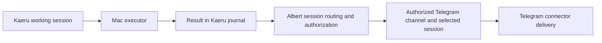
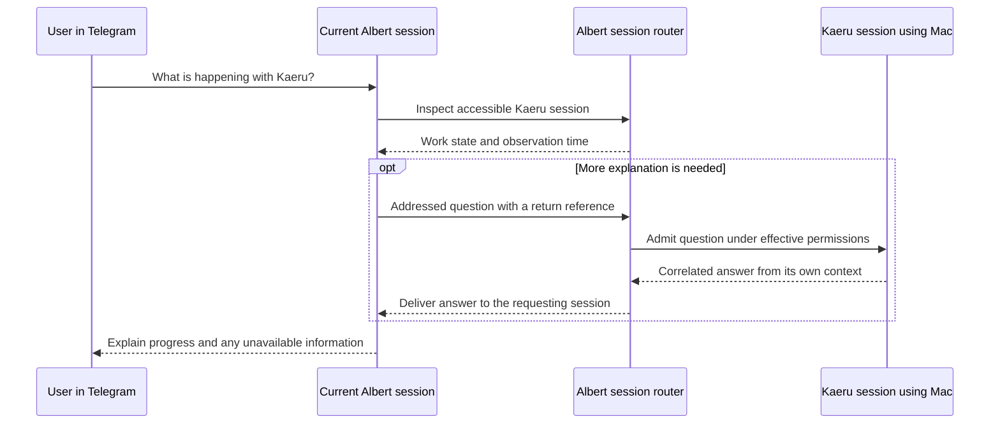

# Session messaging and execution across devices

Status: **accepted architectural direction; implementation pending**.

This document records the agreed direction for communication between Albert
sessions, context exchange, and delivery through different channels while work
runs on different devices. It is a living design: implementation discoveries
should update this document, distinguishing changes to the agreed architecture
from refinements of the contracts below.

## Core decision

**Sessions are logical message recipients over Octo's existing event and channel
infrastructure.** They can exchange questions, requests, results and selected
context. Connectors and channels provide physical delivery. Albert interprets
session addresses, applies access policy and admits messages into the appropriate
conversation or execution scope.

This extends the existing assembly. Octo continues to provide generic envelopes,
routing, connector lifecycle and transport. Session semantics belong to Albert
and the session storage contracts in octo-history. An application session does
not become a special kind of channel baked into Octo's kernel.

Three independent references describe a typical operation:

| Reference | Meaning | Example |
| --- | --- | --- |
| Working session | The conversation owning the work and its context | `Kaeru` |
| Execution target | The machine and connector instance providing execution and local resources | The Mac's sandboxed process connector, reached through its daemon |
| Delivery destination | Where a result or another message should appear | The user's Telegram private channel |

A result can therefore come from work using a Mac executor and arrive in
Telegram. The initial device-daemon design keeps the cogitator and canonical
session history on the server. Another session can ask that working session for
information without moving its execution, changing its identity, or opening it
in the user's current channel.

## Execution location and conversation transport

A session records its default execution location: **a machine and an execution
connector instance**. This is independent of the connector/channel through which
the user is currently talking to Albert. A Telegram conversation can request
work through a process connector on a Mac; opening that session in the web UI
does not move its workspace or execution.

The machine is the reserved server-local `host` or a stable registered device ID
within the selected Albert server. The execution connector identifies the
configured capability on that machine. Connector names and hostnames alone are
not globally unique: two devices can expose a connector with the same name.
User-facing labels can say “forkd · MacBook”; routing retains the resolved device
and connector identities. A server-side device adapter supplies the bridge to a
remote connector, rather than making the local Octo bus span machines.

The user can select a location in the interface or say “inspect the project on
my Mac.” Albert resolves the named machine and an appropriate available
connector under the user's permissions. Ambiguous names or an unavailable target
are surfaced, rather than executing on a different machine silently.

Session metadata describes the default; each admitted operation records its
actual resolved target. A request can explicitly use another machine for that
work without changing the session default. Changing the default applies to
future work and does not retarget an already admitted job or migrate its files.

Placement does not force every tool call in a turn onto one machine or connector.
The same request can inspect files on a Mac and use a server-side tracker
connector. Each operation retains its actual execution location and outcome;
artifacts and paths retain their machine association. The cogitator and canonical
session history remain server-side in this baseline.

## Current foundation and the extension

The [session foundation](sessions.md) already separates Session identity from
connector/channel identity. A private Session belongs to a canonical User and can
be continued through verified identities on different transports. Group sessions
have a separate, channel-bound access policy. The currently supported executor is
`host`, representing the existing Albert server and its workspace.

Current replies use a trusted `ReplyRoute` captured at admission. Selecting a
different session does not retarget work already running. The process-local Octo
bus also does not provide communication between separate machines by itself.

The proposed extension adds explicit message destinations and result-delivery
rules above that foundation. The captured ingress remains the default reply and
feedback route. A deliberate delivery instruction can add or select a different
destination; it does not mutate routing for unrelated active work.

## Addressing

A connector ID alone is insufficient to identify a recipient. One Telegram
connector can serve multiple private and group channels. A usable delivery
destination identifies the connector instance, physical channel and authorized
recipient, plus the intended session-selection mode.

Channel-active destinations require an adapter that supports conversational
messages and session admission. A calendar or SQL connector does not acquire an
active conversation merely because it is present in the connector catalog.
Configured capability, permission to use a channel and current reachability are
separate facts. The destination picker should expose availability and any queued
delivery state rather than treating every configured connector as connected.

Two destination forms are needed:

| Destination | Resolution |
| --- | --- |
| A specific Session | Address a stable Session ID, subject to access and lifecycle checks. A transport can be chosen separately if visible delivery is requested. |
| The active Session of a channel | Resolve the selected Session of a specific authorized connector/channel when dispatching the message. |

The channel-active form implements the intended experience: “send the final
answer to the chat I am using in Telegram.” The fixed-session form implements
“send it to this particular conversation even if I switch chats.”

Names and project labels support discovery; stable IDs identify the resolved
recipient. Ambiguous names must not cause an arbitrary session to receive a
message or execute a request. Routing metadata retains the resolved IDs.

An active-session destination is resolved for its first dispatch, after the
destination's channel binding and permissions have been checked. That resolution
is recorded for the delivery. Retries use the same resolved recipient rather than
following later selector changes and inserting the same message into several
conversations.

If no valid active selection exists, Albert reports an unavailable destination
or uses an explicitly configured fallback. It does not silently create a new
conversation or switch the user's selected session to make delivery succeed.

## Sending a result to another channel

The user can request delivery conversationally or choose an available destination
in the interface. These are two interfaces to the same server-owned routing
operation. A model may propose a destination; the host resolves its identity and
authorization against actual configured channels.

Delivery can be configured for the current work, with an explicit scope such as
the current task, turn, stage or remote job. Existing work identifiers should be
reused where possible. This design does not require a separate mandatory task
framework or persistent scratchpad plans just to send a message.

An instruction applying to current work must not quietly become a permanent
subscription to all future output. Persistent subscriptions, if introduced,
need their own visible configuration and lifecycle. When a destination is
changed, already dispatched messages retain their original recorded route.

Example:

1. The user starts work in the `Kaeru` session using resources on the Mac.
2. The user selects their Telegram private channel as the final-result
   destination, using its active session at dispatch.
3. Work continues in `Kaeru`. The result is committed to that working session.
4. Albert resolves the Telegram destination and admits a linked result message
   into the selected recipient session.
5. The Telegram connector delivers it with its source identified, for example
   “From Kaeru · Mac,” and a reference for opening the original conversation.

The recipient can receive the full final answer or a short notification with a
reference, according to the selected delivery policy. The original session keeps
the authoritative result. The receiving session keeps the message it actually
received and its provenance, so a later conversation can refer to it naturally.

This linked delivery neither switches the recipient's conversation implicitly
nor merges the two histories. Delivering an already generated result does not
require another model invocation solely to forward it.

The user can select destinations for **intermediate reports and final results**
independently, conversationally or in the interface. Each selection identifies
an authorized connector/channel and a fixed-session or channel-active recipient,
with the resolution and retry rules described above. The two report classes may
share a destination or use different ones; both remain scoped to the selected
work. For example, a Mac job can send stage summaries to the web conversation
and its final answer to the user's Telegram conversation.

An intermediate report is a deliberate progress message or stage summary, not
an implicit subscription to raw tool output. Typing, transport status and raw
executor events have their own feedback policy. Requesting a final result in
Telegram does not subscribe that channel to every event from the executor or
move an existing typing/status lifetime to it. Explicitly routing progress also
does not change where the work runs or where unrelated work replies.

## Communication between sessions

Albert needs three application capabilities:

- Discover accessible sessions and work by name, project association or ID.
- Inspect an authorized session's available work state and selected evidence.
- Send an addressed message to a session and receive a correlated response.

Discovery exposes only information the caller may access. Inspecting stored or
live state can answer many questions without waking the other session's model.
State should distinguish running, waiting, completed, failed, cancelled and
unknown work where those states are available, with observation time and executor
availability. A disconnected device's last report is labelled as last observed.

For “what is happening with Kaeru?”, Albert first resolves the relevant session
and examines its state. If that does not answer the question, it can send a
question to the working session: “What has been completed, what remains, and are
there any blockers?” That session can answer using its own context and available
evidence. Its answer returns to the requesting session using the request's
recorded return address and correlation, independently of later UI selection.

A request can also carry an instruction, such as asking the working session to
run another check. Reading state, asking a question and requesting a side effect
remain distinct capabilities and message intentions.

## Message identity and provenance

The following describes logical information, not final Rust fields, SQL schemas,
tool names or HTTP endpoints. Existing Octo envelope identity, correlation and
causality facilities should be reused where applicable.

| Information | Purpose |
| --- | --- |
| Stable application message ID | Identify the same message across admission, retries and transport hops. |
| Origin session and executor | Preserve where the message was produced. |
| Authenticated initiating actor | Record on whose behalf the request is made, independently of the producing model. |
| Destination specification | Address a session directly or select an authorized channel's active session. |
| Resolved recipient and return address | Keep delivery and responses stable once routing has been resolved. |
| Message intention | Distinguish a notice, question, work request, response or control request. |
| Request/correlation and causation references | Associate an answer with its request and retain relay ancestry. |
| Work and context references | Associate the message with existing work and explicitly attached evidence. |
| Lifecycle, deadline and delivery policy | Bound processing, retries and validity. |

The host supplies trusted actor and source metadata. A model-generated JSON body
cannot declare itself to be a human owner or manufacture another session's
authority. An agent message is stored and presented as an agent message, with
its source, rather than impersonating a direct message from the user.

Physical connector/channel identifiers keep their transport meaning. Session
addresses belong in Albert's typed application contract or routing metadata;
they do not replace Telegram chat IDs or generic Octo connector IDs.

## Context exchange

Sessions can pass context deliberately through messages. This includes an
explanation of the request, selected conversation excerpts, a handoff summary,
work-state snapshots, results and references to supporting artifacts.

Each transfer is bounded and identifies its source and snapshot boundary, such
as message IDs, a journal watermark, a compact revision or an artifact revision.
Derived summaries identify themselves as summaries. A “latest” inspection records
which version was actually observed rather than claiming a stable live view of
work that may change immediately afterwards.

The receiving session incorporates the supplied material as attributed context
for that message. Its own history, compact checkpoints and scratchpad keep their
identity. Another session's instructions and tool outputs remain supplied data;
they do not replace the recipient's system instructions or extend its tools.

Large transcripts, logs and files should be provided through bounded excerpts
and authorized references, not automatically copied into every message or prompt.
Fetching further context is an explicit operation with the caller's access and
context budget. Long-term Kaeru memory remains a separate facility: forwarding a
message or context does not automatically promote it into shared memory.

A file path is meaningful in its executor's filesystem. A path on the Mac is not
implicitly readable from the server or another device. Cross-device exchange
needs an authorized artifact transfer or a reference resolved through that
device's connector, with its availability and retention made explicit.

## Admission, queues and interruption

A session is a conversation and work scope; being addressable does not require
it to have a permanently running model loop. Inspection can use state already
available to the host. An admitted question or work request may schedule a turn
when the session is able to process it.

The starting processing defaults are:

| Message | Default handling |
| --- | --- |
| Result or informational notice | Record and display it; do not automatically generate another model answer. |
| State inspection | Read available state without interrupting work or starting a model turn. |
| Question or work request | Admit to a bounded inbox; process at a permitted scheduling boundary. |
| Explicit steer or cancellation | Use a separately authorized control operation and the existing work-cancellation rules. |

The exact scheduling boundary is an implementation detail to settle against the
current cogitator. A question from another session must not automatically enter
the ordinary human-input interrupt path and abort a running tool call. Existing
human interruption behavior remains explicit. Cancelling one request does not
implicitly cancel unrelated work or independent subagents.

Responses return asynchronously. Requesting sessions must not hold execution
gates while waiting for each other. Cyclic requests, automatic reply loops and
unbounded fan-out need configurable budgets, deadlines and bounded queues. Hop
and causation information supports these limits; correlation alone is not a
loop-prevention policy.

## Permissions and session boundaries

The sender must be authorized to discover the recipient, read the context being
exported, send the requested message and use the chosen delivery channel. The
recipient independently checks admission, requested operations and lifecycle.

Delegated work uses effective permissions bounded by the initiating actor's
delegation, the source scope, the recipient's policy and the executor's grants.
A less privileged session cannot gain filesystem, connector or owner access by
asking a more privileged session to perform the same action. Readable evidence
also does not imply permission to execute another session's tools or consume its
native approvals.

Shared ownership or the `owner` role alone is not an identity-linking mechanism.
The first scope is communication between a canonical user's authorized private
sessions and private channels. Cross-user collaboration needs explicit sharing
and delegation policy before it can be enabled.

Existing GroupBound isolation continues to apply. A group session is anchored to
its originating connector/channel. Messaging, inspection and context references
must not bypass that boundary, expose a private session to a group, or make group
history readable from another channel. Any future explicit export/sharing mode
must be designed as a separate permissioned operation.

## Temporary sessions

Temporary sessions retain their existing RAM-only transcript contract until
Save. A durable outbox, remote daemon log or permanent recipient must not quietly
persist their content as an incidental result of messaging.

Forwarding temporary context to a permanent session or an external channel is an
explicit export with visible persistence consequences. Its authorization and
retention policy must be resolved before enabling that route. Without such a
policy, keep the transfer within permitted volatile storage or require Save.

Resolved destinations also carry lifecycle validity. If a temporary recipient
ends before delivery, retries cannot resurrect it or silently redirect its
messages into the conversation to which the user returned. An ended source does
not leave a pending request with unlimited execution authority. Work already
committed externally keeps its actual outcome; ending a chat cannot roll it back.

## Devices and remote daemons

Session messaging provides the logical addresses. A device connector and an
authenticated bridge provide transport to a remote daemon or runner. Octo's
current in-process bus remains local; transport adapters connect runtimes or
executors without assuming shared memory or a shared filesystem.

The saved remote-runner direction remains applicable: stable job IDs, idempotent
submission, status, bounded logs, cancellation, artifact retrieval and recovery
after connection loss. A notification can refer to an existing remote job or
stage instead of inventing another independent work identity.

Process-local native authorization objects cannot be serialized and trusted by
another machine. The remote endpoint authenticates the connection, validates
the delegated request and enforces its own grants before reconstructing local
execution context. Connector access and executor limits remain server-enforced.

The currently implemented executor placement is still `host`. The agreed
[device-daemon baseline](device-daemons.md) keeps the cogitator and canonical
history on the server, with sandboxed script/tool execution on devices. Shared
packages and lazy skill delivery are optional distribution mechanisms. Authorized
data or credential copies are allowed where execution requires them; per-node
placement remains explicit.

The device daemon is a separate, long-lived process. The `albert.cli` Ratatui
prototype is a client of its local API; closing the CLI does not stop accepted
jobs. The daemon connects outward to the Axum server using reqwest HTTP and
Tungstenite WebSocket. Those connection lifetimes do not define Session identity.
Local clients use a shared CBOR command/event protocol over compile-time Unix
socket or Windows named-pipe backends. The initial server-device control link
uses JSON over HTTP/WebSocket; network CBOR and other transport optimizations
remain future options pending measurement. These device contracts do not
redefine Octo's kernel envelope or the web UI's HTTP representation.

An authorized user creates a named connection token in the server's panel, then
connects a daemon by server address and token. Registration reports hostname and
OS; the token's name supplies an initial alias. One daemon can retain several
server profiles with separate credentials, grants and session namespaces.

Device-backed sessions display the device hostname, with an optional alias, but
retain a stable server-scoped executor reference internally. The reserved `host`
continues to mean server-local execution. Viewing a session through another
device or switching a CLI server profile does not migrate its executor or work.

A complete local cogitator is a separate possible operating mode. Logical
messaging should preserve the session's user-visible identity across these
placements. Moving running work between executors still requires an explicit
handoff protocol; forwarding a message does not itself implement migration.

## Persistence and delivery outcomes

Permanent conversation content remains in octo-history. Albert owns routing,
inbox/outbox admission, subscriptions and delivery receipts, using the internal
storage boundary. This does not create a second session catalog or require
persisting every scratchpad plan.

For retained work, committing a result and recording its pending delivery must
have a recoverable relationship. After a process or device restart, reconciliation
can determine whether notification remains pending without rerunning completed
work or generating a different result. The exact transaction/outbox integration
is an implementation detail; an in-memory callback alone is insufficient.

Acceptance into an inbox, completion of requested work and physical channel
delivery are separate outcomes. A transport acknowledgment is not proof that a
person has read the result. Status exposes queued, failed, expired and unknown
outcomes where appropriate, instead of reporting every accepted send as delivered.

Stable application message IDs and recipient-side receipts make retries
idempotent where Albert controls admission. A connector may still have an
ambiguous external send outcome; Telegram and other services do not gain an
exactly-once guarantee from an internal message ID. Reconciliation and retry
policy must preserve that uncertainty honestly.

Queue, payload, context, retention and retry limits are configurable. Delivery
bookkeeping can expire under its own retention policy without deleting the
conversation's retained history or adding a new TTL to the RAM scratchpad.

## Details to resolve during implementation

The architectural direction above is agreed. The following contracts remain to
be refined against the code and documented here as decisions are made:

- The typed Albert message contract, application event kinds, versioning and
  authenticated bridge format, using existing Octo mechanisms where applicable.
- Session discovery and project association, including ambiguous-name handling
  and stale/offline state presentation.
- Inbox scheduling boundaries, bounded response waits and explicit steering
  behavior alongside current interrupts and subagent independence.
- Transactional result/outbox integration, receipt lifecycle and recovery after
  an unknown external send outcome.
- The minimum daemon/runner protocol and its platform-specific execution
  adapters, following the server-cogitator baseline; executor migration is a
  separate extension.
- The interface for choosing per-work destinations, changing them while work is
  active, and distinguishing fixed-session from channel-active routing.
- Temporary-content export policy, cross-device artifact access and optional
  future collaboration grants.

The Mac-to-Telegram result and the “ask the Kaeru session” exchange are the two
reference scenarios for keeping these decisions coherent.

## Related documents

- [Sessions](sessions.md): identity, private/group boundaries, temporary lifecycle
  and retained journals.
- [Architecture](architecture.md): Octo as the generic runtime and Albert as the
  userland cognition layer.
- [Subagents](subagents.md): delegated capabilities, independent work and results.
- [Stage planning](stage-planning.md): work references and scoped RAM scratchpads.
- [Device daemons](device-daemons.md): server cognition/history, sandboxed device
  execution and possible lazy skill-package delivery.
